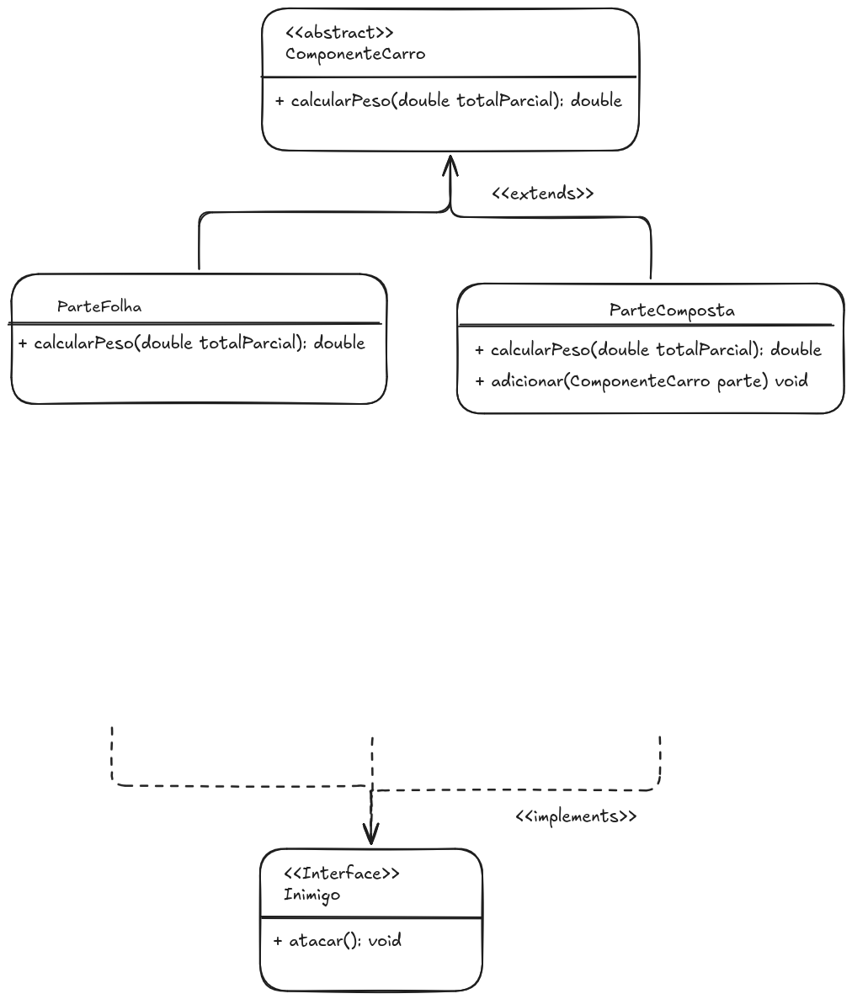

# Padrão Composite — Peso Total de um Carro

Trabalho prático sobre o padrão de projeto **Composite**, aplicado ao cálculo do peso total de um carro a partir da soma dos pesos de suas partes.

---

## 📋 Prompt Utilizado

Me dê um passo-a-passo de como gerar a solução para o seguinte problema proposto:

Um carro é composto por uma carroceria e um chassi. A carroceria é composta por
para-lamas, portas, painéis, porta-malas e capô. Já o chassi é composto por um trem
de força e suspensão. Por fim, o trem de força é composto por um motor, transmissão,
diferencial e rodas. Essas diferentes partes de um carro apresentam como
características nome e peso.
• Usando o padrão Composite, desenhe um diagrama de classes e codifique um
programa que calcula o peso total de um carro.
• Você é livre para atribuir o peso que quiser às diferentes partes de um carro.
• Sempre que o peso de uma parte do carro estiver sendo contabilizada, você
deverá imprimir na tela:
“Somando agora o peso de NOME_DA_PARTE: PESO_DA_PARTE. Total
parcial: SOMA_PARCIAL”

• Seus artefatos (diagrama e código) devem ser tão simples quanto possível,
servindo apenas para ilustrar a situação descrita acima com o emprego do
padrão de projeto solicitado.

---

## 🧩 Diagrama de Classes

